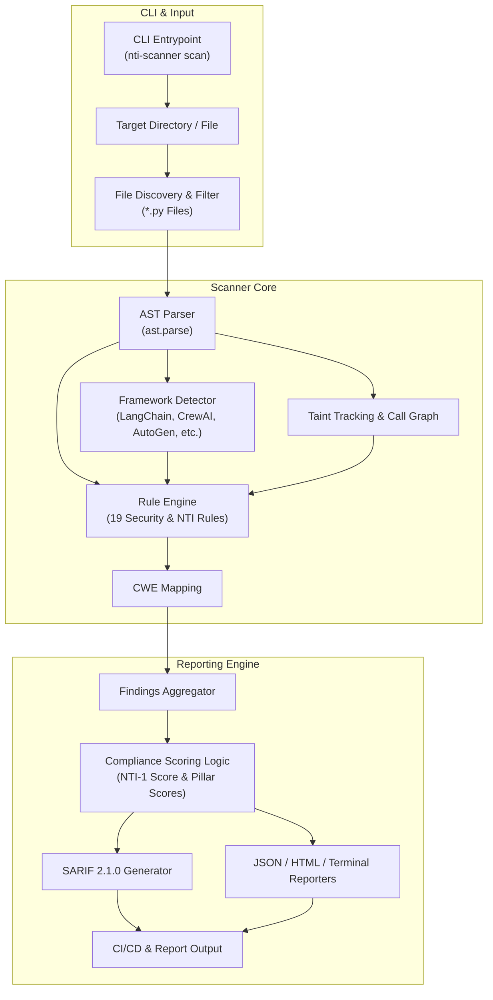

[](https://nti-registry.vercel.app)

# nti-scanner

Professional SAST engine for AI agent compliance and security. AST-based analysis, taint tracking, CWE mapping, and SARIF output for CI/CD pipelines.

[](https://opensource.org/licenses/Apache-2.0)
[](https://pypi.org/project/nti-scanner/)

---

## Features

- **AST Analysis Engine**: Analyzes Python codebases without executing untrusted code.
- **19 Security & NTI-1 Compliance Rules**: NTI-1 compliance pillars plus OWASP AI Agent Security risks.
- **CWE Mapping & SARIF 2.1.0**: Generates GitHub Security tab compatible SARIF reports.
- **Framework Detection**: Auto-detects LangChain, CrewAI, AutoGen, OpenAI, Anthropic frameworks.
- **MCP & A2A Security Rules**: First SAST engine with dedicated MCP protocol and Agent-to-Agent security rules.
- **Post-Quantum Cryptography (PQC) Readiness**: Scans for classical asymmetric crypto vulnerable to quantum attack.
- **Agent Behavior Graph**: Builds and exports structural behavior graphs of agents and tool sinks.

---

## Installation

```bash
pip install nti-scanner
```

---

## Usage

### 1. Scan a Codebase

```bash
# Terminal output
nti-scanner scan ./my-agent-project

# SARIF output for GitHub Security tab
nti-scanner scan ./my-agent-project --format sarif --output report.sarif

# JSON report
nti-scanner scan ./my-agent-project --format json --output report.json

# HTML report
nti-scanner scan ./my-agent-project --format html --output report.html

# Enforce minimum compliance score in CI/CD
nti-scanner scan . --min-score 80
```

### 2. List All Rules

```bash
nti-scanner rules
```

### 3. Generate Behavior Graph

```bash
nti-scanner graph ./my-agent-project --output graph.json
```

---

## Supported Rules (19 Rules)

| Rule ID | Category | Severity | CWE | Description |
| ------- | -------- | -------- | --- | ----------- |
| `NTI-IDENT-001` | Identity | High | CWE-287 | Cryptographic agent identity (PQC signatures) |
| `NTI-GOV-001` | Governance | Critical | CWE-862 | Zero-trust capability bounds on tool functions |
| `NTI-CONS-001` | Consensus | Medium | CWE-703 | Multi-agent Byzantine Fault Tolerant (BFT) consensus |
| `NTI-AUDIT-001` | Audit | High | CWE-778 | Merkle-chained audit trail for agent actions |
| `NTI-PERS-001` | Persistence | Low | CWE-353 | Cryptographic state persistence integrity |
| `NTI-CAPDIFF-001` | Governance | Critical | CWE-862 | Unauthorized tool capability declarations |
| `NTI-TRUST-001` | Security | High | CWE-1426 | Trust boundary crossing without NTI verification |
| `SEC-PROMPT-001` | Security | High | CWE-1336 | Unsanitized user input in prompt f-strings |
| `SEC-CMD-001` | Security | Critical | CWE-78 | Command injection via os.system / subprocess shell=True |
| `SEC-PATH-001` | Security | High | CWE-22 | Path traversal in file operations |
| `SEC-SSRF-001` | Security | High | CWE-918 | SSRF via dynamic URLs in HTTP requests |
| `SEC-SQL-001` | Security | Critical | CWE-89 | SQL injection in agent tools |
| `SEC-SECRET-001` | Security | Critical | CWE-798 | Hardcoded API keys or credentials |
| `SEC-DESER-001` | Security | Critical | CWE-502 | Unsafe deserialization (pickle, yaml.load) |
| `SEC-CAP-001` | Security | High | CWE-269 | Agent tool with destructive capability |
| `SEC-LLM-001` | Security | High | CWE-1426 | LLM output passed to eval() or exec() |
| `SEC-MCP-001` | Security | High | CWE-287 | MCP integration without authentication |
| `SEC-A2A-001` | Security | High | CWE-287 | Agent-to-Agent protocol missing identity verification |
| `SEC-PQC-001` | Identity | High | CWE-327 | Quantum-vulnerable classical cryptography (RSA/ECDSA) |

---

## Python API Usage

```python
from pathlib import Path
from nti_scanner.scanner import scan_directory

result = scan_directory(Path("./my-agent-project"))
print(f"Compliance Score: {result.nti1_score}/100")
print(f"Frameworks: {result.frameworks}")
for finding in result.findings:
    print(f"[{finding.severity.upper()}] {finding.rule_id}: {finding.message} ({finding.file}:{finding.line})")
```

---

## License

Apache License 2.0. See [LICENSE](LICENSE).

## Links

- NTI Specification: https://abisheakp197.github.io/nti-spec/
- GitHub Repository: https://github.com/abisheakp197/nti-scanner

---

## Architecture


